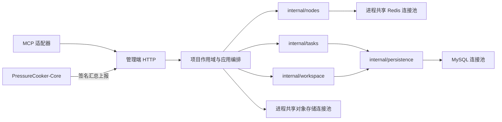

# 后端架构与模块边界

管理平台采用 Go 模块化单体，执行代理及 MCP 仍为独立 Go 模块。新执行采用显式项目/目标契约，数据库通过连续迁移升级；工作区历史密文、不可变版本与任务快照保留原始证据。

## 所有权与依赖

`newPlatform` 创建进程所有者。`forProject`、`forRequest` 返回借用资源的值副本；项目 ID 与请求 Context 不写回父对象。请求结束或关闭借用句柄不会关闭进程资源。后台调度使用未绑定请求的进程对象，可按已有规则处理各项目任务。

Redis 和对象存储客户端按完整配置复用。不同地址、数据库、命名空间或凭据不会误用旧客户端；正常运行配置由启动时确定。客户端缓存不保存业务载荷，不对 API 或日志输出配置键和秘密。只在进程所有者关闭时释放共享 Redis 和对象存储空闲连接；不改变对象存储传输的大小、SHA256、不可变写入及网络无进度超时规则。

HTTP 先停止接入，再等待在途请求完成；最多保留现有 5 秒关闭预算，超时关闭连接以取消请求。HTTP 与后台循环结束后才关闭进程依赖和数据库池。

## 持久化与取消

`internal/persistence` 负责数据库/事务包装、测试表命名空间及 Context 绑定。请求数据库视图共享物理连接池，仅借用自己的 Context。旧 `Query/QueryRow/Exec` 通过视图继承取消；新仓储显式传入 Context。事务沿用原死锁/冲突重试规则，重试等待也可取消。

`contextQueryer` 仅适配仍使用旧查询接口的边界。后台启动、有限时的补偿清理与关闭预算可使用独立 Context；不能把 HTTP 取消信号换成无期限后台操作。请求中的脚本对象上传及归档日志下载使用请求 Context。取消和超时保持 `499/request_cancelled`、`504/request_timeout`，错误脱敏保留 Context 原因而不回显传输 URL。

## 节点域

`internal/nodes.Registry` 通过窄 `ReportStore` 接口读写 Core 汇总。节点状态、机器信息、来源、上报时间和各 Core 的私有 worker 观测使用强类型模型。域内负责 20 秒新鲜度、worker 相对采样年龄、跨 Core 选择、最近不可达观测与观测 epoch。

HTTP 层保留 HMAC 身份校验和严格 JSON 解码；main 中的兼容投影维持现有 API 的数字、null、缺省字段和集群私有证据约定。管理端没有节点 `/status` 探测或回退。5 秒上报、24 小时缓存与显式集群成员配置见[节点注册与状态](节点注册与状态.md)。

## 任务域

`internal/tasks` 提供强类型状态、停止决策和失联终态策略。任务仓储集中读取、列表与保存，记录使用类型化 ID、状态、创建时间、项目 ID 和不透明载荷字节。

仓储不解析业务 JSON、不加解密、不重新生成任务快照。应用层继续负责冻结集群、环境密文、签名任务、事务 outbox、租约、attempt、代次、epoch 和回调去重。调度器只恢复当前 Redis owner；旧 HTTP 调度、无归属重置和旧归档轮询已退出，历史活动记录由显式审计/退役工具处理。

## 工作区域

`internal/workspace` 使用固定表枚举管理流程、接口集合及环境；不接受任意表名。`Record/Version/Summary` 通过窄 SQL 接口进行项目过滤、CRUD、历史与摘要读取。列表先物化并关闭游标，再进行解密或后续读取，支持单连接池。

缺少旧摘要投影时仅批量读取当前页缺失的载荷，避免逐条查询。锁、修订冲突、不可变版本和摘要写入仍在原事务内。历史无 project_id 的密文使用数据库所有权生成内存投影，不重写密文。

AES-GCM、AAD、规范序列化、接口描述、变量与协议校验仍由现有应用编排负责。CSV/编辑器派生数据构造、专业报告/outbox 查询和部分旧回调代码也保留在 main；不能把本轮提取说成所有业务类型均已迁移。

## 查询与数据兼容

当前采用 schema 10：查询投影和索引由前序迁移维护，历史删除墓碑与制品清理队列由 `008_history_deletion.json` 维护，009维护独立扩展目录/不可变定义，010维护监控去重证据及版本成员。大文档与加密内容保持载荷，不为了类型化仓储批量改写历史数据。热字段在 SQL 中过滤，摘要分页与排序保持原契约。

测试命令和隔离依赖规范见[测试基线与验收](测试基线与验收.md)。验收使用私有 Redis、随机 MySQL 表前缀与通用本机 HTTP/JVM 夹具；不启动真实业务压测。标准测试必须使用规范化临时路径（macOS 使用 `/private/tmp`），不能为测试放宽符号链接保护。

扩展定义与运行能力分层：独立目录使用各自CAS修订，发布版本内容不可覆盖；新画布/消息展示选择固定版本，历史无版本引用保留。删除/停用后引用回退原文。当前没有可信远端JAR能力采集，因此目录 `runtime_status=unknown`，不会从编辑启用推断运行通过。`internal/interfaceprotocol.Ports` 预留 Validate/Debug/Compile/Capabilities，Registry 按准确协议和编码显式注册；目前未挂载新协议实现，RPC/gRPC/Protobuf仍被既有执行守卫拒绝。不要将预留端口视作已上线能力。
