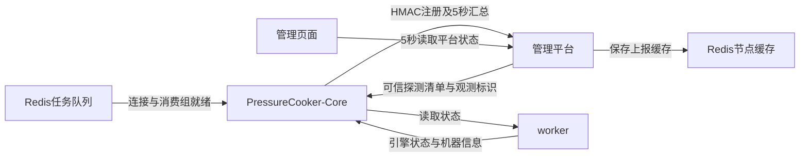

# 节点注册与状态

容器运行表示进程存在；节点“空闲”表示当前没有执行任务。执行任务时才显示“运行中”。机器资源、队列连接、节点就绪和任务状态分别展示，不能互相代替。

## 上报链路

管理平台不主动请求Core或worker的节点状态。只有Core能够提交 `POST /api/nodes/report`；worker不直接注册到平台。Core首次确认Redis及消费组就绪后开始注册，HTTP或Redis故障时自动重试。首次成功连接后若队列断开，后续报告明确携带断开状态。

Core由平台配置获得可信worker探测清单，主动汇总其状态。各Core可观测完整worker池以便故障恢复；每个集群的执行成员独立配置，观测清单不授予执行权限。标准两Core六worker部署初始分为2/4，配置页保存的映射优先。内部 `controller-a/controller-b`、集群标识、RMI地址和历史任务快照保持原样，默认展示名称为 `PressureCooker-Core-1/2`。

## 真实性与过期

HMAC签名校验节点身份、请求及正文，平台只接受配置清单中的Core和worker。报告不能修改节点地址、集群成员或执行权限。平台以服务端接收时间判定报告新鲜度，超过20秒标记超时，保留最近一次报告24小时供查看。Core心跳不能把已经过期的worker观测重新算成新鲜；多个Core的观测优先使用有效的新鲜信息，来源可见。

页面区分未收到上报、上报超时、worker不可达、队列断开、引擎恢复、空闲及执行中。Core新启动有独立boot标识和递增序号，延迟旧包或同序号重试不覆盖新进程，也不刷新旧状态的有效期。

CPU和内存优先读取容器cgroup额度与用量；宿主物理内存单独标注，可见逻辑CPU不等于容器CPU额度。磁盘来自工作目录所在文件系统，不代表容器磁盘配额。无法取得的数值保持缺失，CPU使用率首个样本保持未知，实际零值保留。

## 失联恢复

任务队列、全局执行租约、attempt、代次和回调校验保持有效。管理端取代直接节点探测，读取Core汇总缓存。恢复取得独占租约后，ACK携带该租约的不可逆观测标识；Core收到新标识后重新读取worker，再带标识上报。只有对应本次恢复的新鲜空闲证据才能推进清理，旧缓存不会被当作当前复位确认。没有有效证据时保守等待，不伪造恢复成功。

## 配置

- `PRESSURECOOKER_MANAGER_URL`：Core可访问的管理平台HTTP(S)基础地址，默认 `http://manager:8080`。
- `PRESSURECOOKER_NODE_NAME`：节点展示名称；标准Compose分别为Core-1、Core-2。
- `PRESSURECOOKER_CLUSTER_WORKERS`：JSON初始成员映射；标准Compose显式配置2/4，已保存集群配置优先。不根据节点数量猜测分组；原生manager须配置控制器与worker地址清单，未配置时为空。未指定成员映射的控制器显示待配置、成员为空，不能执行；部署须明确保存成员关系。

节点ID使用执行协议的通用标识（1至128个字母、数字、下划线、点或短横线，首字符不能为点或短横线），必须存在于部署配置清单且不能重复；当前每个Core观测完整worker清单，因此部署清单、集群及单次任务均最多64个worker，与状态上报和任务协议边界一致，超限在启动时拒绝。扩容时同时配置Core可探测清单、执行节点地址和集群成员，不通过节点名称推断权限。标准2/4只是部署布局。
- Redis连接与agent-token沿用现有私有文件和签名配置，不写入报告正文或浏览器偏好。

部署后应检查Core与worker上报时间是否持续推进、队列连接、机器额度及2/4分组，并在空闲时验证一次节点停启后的失联与恢复。该检查不需要执行真实业务压测。
